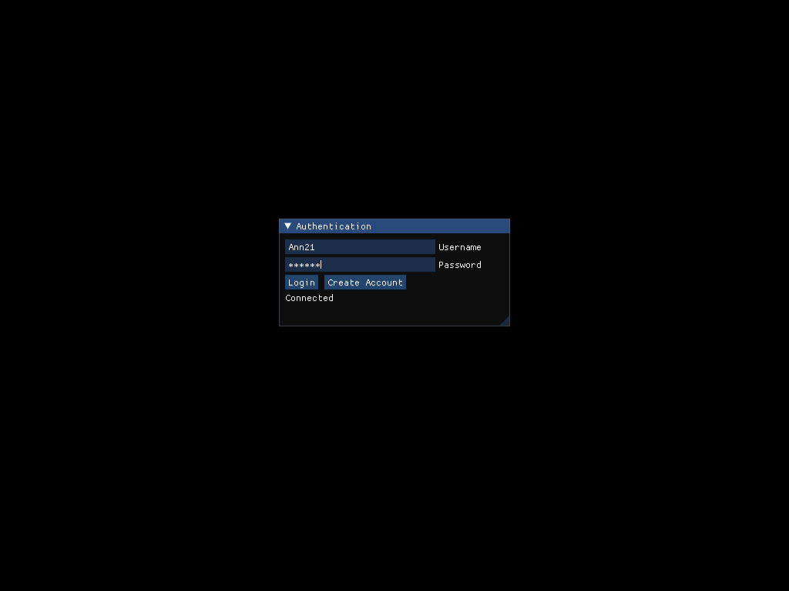
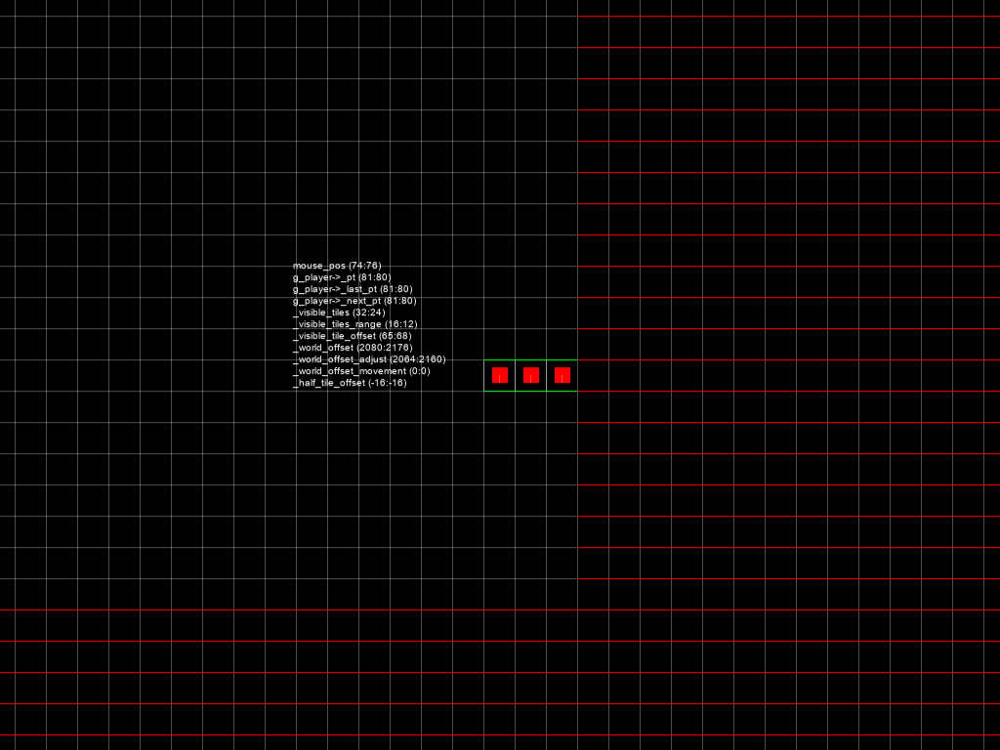
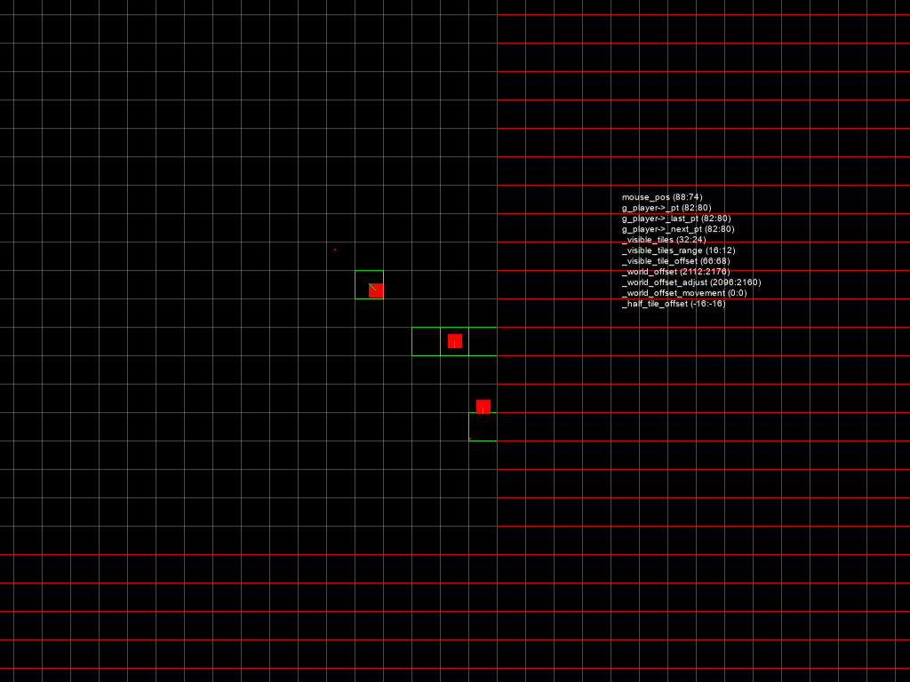
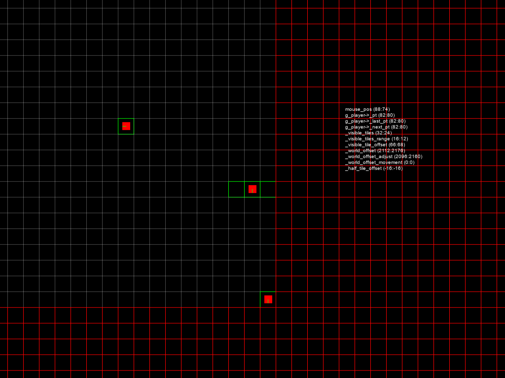

# tiled

A tile-engine strategy game prototype: log in, walk a 100 x 100 tile map with the
mouse and see the other players move. An SFML client, an ENet server with its
accounts in MySQL, on kazilib.

**Made without AI** until the first Claude commit (ec1df2b, 2026-11-06); AI was used after that for the updated deployment and this README.

**Play it in your browser: https://kazin.dev/projects/tiled/** (make an account in the
window: a name of letters, digits, `_` or `-`, up to 32 characters; then Login)


Left click a tile: walk there, a tile at a time. Right click: face that way.
Numpad `-` / `+`: zoom. The grid's red lines are the map's edge band, green tiles
are taken by a player. The text by the cursor is the camera's debug read-out.

## Libraries

| Library | Version | Where |
|---------|---------|-------|
| kazilib | master (submodule, private) | `src/dep/kazilib`: enet 1.3.18 and its packet layer (`net/packet.h` `OPkt` / `IPkt`, `net/socket.h`, `net/broadcaster.h`), the WebSocket gateway (`net/ws_gateway.h`), Dear ImGui with imgui-SFML, `scene/manager.h`, `initflags.h`, `log.h`, `stdnames.h`, magic_enum, FASTBuild runner, web builds (`web/`) |
| SFML | 3.1.0 x86 | `src/dep/SFML-3.1.0`: a junction to `D:\code\kazilib\SFML-3.1.0`, or the official vc17 32-bit release |
| MySQL Connector/C | 6.1.11 x86 (Windows server) | `src/dep/mysql-connector-c-6.1.11-win32`, downloaded by `setup.ps1`; Linux: `libmysqlclient` |

**kazilib is a private repository**: building needs access to
github.com/xkazinx/kazilib (the submodule `src/dep/kazilib`).

## Building (Windows)

Visual Studio 2026 (v145 toolset). FASTBuild v1.20 is found next to the checkouts or
downloaded once.

```
git clone --recurse-submodules https://github.com/xkazinx/tiled.git
powershell -ExecutionPolicy Bypass -File build.ps1
```

`build.ps1` runs `setup.ps1` (the kazilib submodule, SFML, the MySQL connector), then
kazilib's FASTBuild runner (`src\dep\kazilib\fastbuild\`) on `src\fastbuild.json`:
Release, x86, with the 64-bit-hosted compiler and linker, distributed to the workers
that answer (MSBuild when FASTBuild is missing). The FASTBuild config is generated
from the `.vcxproj` files. Output: `deploy\server\server.exe` (with `libmysql.dll`) and
`deploy\client\client.exe` (with the SFML DLLs); the fonts are `deploy\data\`.
`build.ps1 client` / `server` builds one; `-Configuration Debug` only when needed.
Visual Studio builds the same thing from `src\tiled.sln`.

## Running

1. A MySQL 8 database: create the database and a user, then the table:
   `mysql tiled < src\server\sql\schema.sql`.
2. `deploy\server\init.json` (never committed; the shape is
   `src\server\init.json.example`): `db_host`, `db_port` (3306), `db_user`, `db_pass`,
   `db_name`. Connector/C 6.1 needs the user on `mysql_native_password` and no TLS
   (TLS is off for `localhost` / `127.0.0.1`; `db_ssl` sets it).
3. Start `deploy\server\server.exe`, then `deploy\client\client.exe` twice: make an
   account (Create Account), then Login.

Launch flags (kazilib `initflags.h`: `flag`, `flag=value`, or `init.json` beside the exe):

| Flag | Where | What |
|------|-------|------|
| `ip=` / `port=` | client | the server (default `127.0.0.1:7031`) |
| `port=` / `ws=` / `ws_bind=` / `web=` | server | ENet port (7031); the WebSocket gateway's port (7030, `0` = off), its address (`127.0.0.1`), the web build it serves (default the exe's `web\`) |
| `db_host=` `db_port=` `db_user=` `db_pass=` `db_name=` `db_socket=` `db_ssl=` | server | the database |
| `user=` / `pass=` | client | fill the login window |
| `create` / `autologin` | client | make the account / log in once connected (tests) |
| `walk=<dx>,<dy>` | client | walk that far after entering (tests) |
| `debug` | both | the per-packet traces |

Passwords are kept as SHA-256 of a random salt and the password (`players.password`).

## In a web browser

Play at **https://kazin.dev/projects/tiled/**. The same client compiled to
WebAssembly (Emscripten) plays against the same server as the Windows clients.

- **SFML 3.1 and ImGui in a browser**: kazilib's web builds (`src\dep\kazilib\web\`,
  its README): SFML's window on SDL3, its drawing on WebGL2; imgui-SFML draws through
  SFML there.
- **The network**: the client keeps its ENet code. In a browser, kazilib's
  `enet/websocket.cpp` carries it over one WebSocket to the server's gateway (kazilib
  `net/ws_gateway.h`), which hands each browser to the server as an ENet peer on
  loopback. By default the WebSocket is the page's folder + `ws`; `?ws=wss://host/path/ws`
  names another. The page's query string is the launch flags (`?debug`).

```
powershell -ExecutionPolicy Bypass -File build_web.ps1
```

`build_web.ps1` builds the client from `src\client\CMakeLists.txt` against kazilib's
SFML web build (`D:\code\tools\kazilib-web`, else built once into `src\build\web`) and
copies it to `deploy\server\web\`. Start `deploy\server\server.exe` and open
http://127.0.0.1:7030/.

## Linux server and the deployment

```
powershell -ExecutionPolicy Bypass -File build_linux.ps1     # src\build\linux\tiled_server
powershell -ExecutionPolicy Bypass -File deploy_ubuntu.ps1   # both builds, upload, install
```

The Linux server is built in a Docker container of Ubuntu 26.04 (the box's system)
with `libmysqlclient-dev`, from `src\server\CMakeLists.txt`. `deploy_ubuntu.ps1` sends
it, the web build and the schema to the box `kazin-music` with `deploy\ubuntu\`, and
installs them (`install.sh`):

- `/opt/tiled/bin/tiled_server`, run as the systemd service `tiled` (user `tiled`): ENet
  on UDP 7031, the gateway on 127.0.0.1:7030.
- The box's MySQL: database `tiled`, user `tiled@localhost` with a random password
  made on the first install and kept in `/opt/tiled/bin/init.json` (mode 600, owned by
  `tiled`); `schema.sql` applied on every install.
- `/opt/tiled/web`, served by Caddy: `/etc/caddy/sites/kazin.dev.d/tiled.caddy`.
- Logs: `journalctl -u tiled`.

## Testing

`src\tests\web\run_web_test.ps1`: two headless browser tabs (kazilib
`web\tools\browser.js`, Edge with WebGL2 on SwiftShader) each make an account and log in
through the ImGui window, see each other, and one walks while the other sees it move.
Locally it starts the Windows server (ports 7035 / 7034) and a native client first, so
the browsers and the native client share one game; `-Url https://kazin.dev/projects/tiled/`
runs it against the live page. Screenshots in `testerino\web\`.

## Showcase

| | |
|---|---|
|  |  |
|  |  |

---

## Original README (2021-08-12, 901ffc3)

# Tileship: Strategy Turn-Based Tile-Engine Game

1. Download [Visual Studio Community 2019](https://visualstudio.microsoft.com/es/downloads/)
  
2. Create folder `C:\LIBPATH`
> All dependencies will be stored here to share between various projects
- Create environment variable for the created folder
  - Press Windows key
  - Search for `edit the system environment variables`
  - Click on `Environment Variables`
  - Click `New`
  - Set name as `LIBPATH` and value as `C:\LIBPATH`
  
3. Download [SFML](https://www.sfml-dev.org/files/SFML-2.5.1-windows-vc15-32-bit.zip)
- Extract in `LIBPATH` folder

4. Download and Compile [ENet](http://enet.bespin.org/Downloads.html)
- Extract in `LIBPATH` folder
- Run project `enet.dsp`
- In `Solution Explorer`, right click the `enet` project, press on `Properties` and in `C/C++`->`General` change `Debug Information Format` from `Program Database for Edit and Continue (/ZI)` to `Program Database (/Zi)`
- Build Solution (Ctrl+Shift+B) both in `Debug` and `Release` (the dropdown to toggle between them can be found at the top)
> This will generate `enet.lib` to use it both in `Debug` and `Release` projects

5. Download and setup latest `MySQL Server` from [MySQL Community Installer](https://dev.mysql.com/downloads/windows/installer/8.0.html)

6. Download [MySQL C Connector 6.1 - Windows (x86, 32-bit), MSI Installer](https://downloads.mysql.com/archives/c-c/)
> Should be automatically be installed in %ProgramFiles(x86)%\MySQL\
> This provides the `include` files and `.dll` files for the `server` project

7. Clone `tileship` repository

8. Run `symlinks.bat` as Administrator
> This will link `.dll` files from libraries placed at LIBPATH folder into the `deploy` project's directories

9. Open `src\tileship.sln`
- Build Solution (Ctrl+Shift+B)

10. Setup Debugging and opening with Ctrl+F5
> Client
- In `Solution Explorer`, right click the `client` project, press on `Properties`, and in `Debugging` set:
  - Make sure to first set `Configuration` at top as `All configurations` so that it applies both for Debug and Release
- Command: `$(SolutionDir)..\deploy\client\$(TargetName)$(TargetExt)`
- Working Directory: `$(SolutionDir)..\deploy\client\`
> Server
- In `Solution Explorer`, right click the `server` project, press on `Properties`, and in `Debugging` set:
  - Make sure to first set `Configuration` at top as `All configurations` so that it applies both for Debug and Release
- Command: `$(SolutionDir)..\deploy\server\$(TargetName)$(TargetExt)`
- Working Directory: `$(SolutionDir)..\deploy\server\`

##Workflow

- Use a MySQL Manager like [HeidiSQL](https://www.heidisql.com/)

- Use [Virtual Assist X](https://www.wholetomato.com/downloads) (recommended)
  > Visual Studio extension that provides tools for faster code browsing and development
  - To reset trial every 30 days:
    - Remove all `*.TMP` files in `C:\Users\[UserName]\AppData\Local\Temp`
    - Remove registry folder at "HKEY_CURRENT_USER\SOFTWARE\Licenses"
  
- Use Visual Studio's `Live Share` (download from Visual Studio 2019 itself)

- Use [Google Drive](https://www.google.com/intl/es/drive/download/) to sync the compiled `client.exe` and `server.exe`
  > So when using `Live Share` and host's computer compiles the projects, it could be set with `symlinks` so that the compiled files are shared with the host and the participants

- Use [AnyDesk](https://anydesk.com/es) in case we both need remote access
  > Like, to see something in the same executable, code synchronously, or debug at the same time
